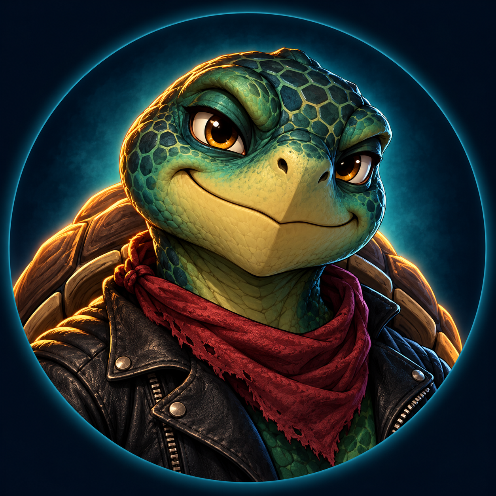

# 🐢 RebelTortuga

**Free Tools • Gaming Utilities • AI Experiments • Open Source**

Hey! I'm **Adam**, the rebellious turtle behind RebelTortuga.

I'm an independent creator, gamer, and tech enthusiast who enjoys solving problems, experimenting with AI, and building tools that make technology easier for everyone.

**My philosophy: Useful tools should be accessible to everyone—not hidden behind paywalls.**

## 🔧 What I'm Building

- 🎮 **Gaming Utilities** — Diagnostic, troubleshooting, and repair tools.
- 🤖 **AI & ComfyUI** — Custom nodes, image workflows, and creative experiments.
- 🛠️ **Windows Utilities** — Practical tools that simplify computer tasks.
- 💡 **Open-Source Projects** — Free solutions and experimental ideas.

## 🚀 Featured Project

### [ComfyUI Clean Slate](https://github.com/RebelTortuga/comfyui-clean-slate)

A free custom ComfyUI node for selectively clearing connected images and prompts while preserving saved files and workflow connections.

## 🔎 Explore My Free Software

Free Windows diagnostic and repair tools, gaming utilities,
ComfyUI custom nodes, and local AI workflows.

### 🎮 Windows and Gaming Toolkits

| Project | Description |
|---|---|
| [World of Warcraft Diagnostic and Repair Toolkit](https://github.com/RebelTortuga/wow-diagnostic-and-repair-toolkit) | Free WoW diagnostics, troubleshooting, and repair tools. |
| [Firefox Diagnostic and Repair Toolkit](https://github.com/RebelTortuga/firefox-diagnostic-and-repair-toolkit) | Firefox troubleshooting and repair utilities. |
| [Brave Diagnostic and Repair Toolkit](https://github.com/RebelTortuga/brave-diagnostic-and-repair-toolkit) | Brave browser diagnostics and repair utilities. |
| [Shell Diagnostic and Repair Toolkit](https://github.com/RebelTortuga/shell-diagnostic-and-repair-toolkit) | Windows shell diagnostic and repair tools. |

### 🤖 ComfyUI and Local AI Workflows

| Project | Description |
|---|---|
| [ComfyUI Clean Slate](https://github.com/RebelTortuga/comfyui-clean-slate) | Clear connected images and prompts while preserving workflow connections. |
| [Qwen Image Editing](https://github.com/RebelTortuga/comfyui-free-local-qwen-image-edit) | Free local AI image-editing workflow. |
| [SDXL Inpainting](https://github.com/RebelTortuga/comfyui-free-local-sdxl-inpainting) | Free local SDXL image-inpainting workflow. |
| [Wan Video Quality](https://github.com/RebelTortuga/comfyui-free-local-wan-video-quality) | Free local Wan video workflow focused on quality. |
| [Wan Video High Resolution](https://github.com/RebelTortuga/comfyui-free-local-wan-video-high-resolution) | Free local high-resolution Wan video workflow. |

Visit each repository for documentation, requirements, and available downloads.

## 🤝 Feedback & Contributions

Found a bug or have an idea?

Suggestions, bug reports, and constructive feedback are always welcome. Visit the relevant repository and open an issue.

## ☕ Support RebelTortuga

Everything I create is intended to be free to use.

If my work has helped you, saved you time, or made your day easier, consider supporting future development.

### 🐢 [Help This Turtle Get a New Shell!](https://ko-fi.com/rebeltortuga)

Donations are completely optional.

**No pressure. No paywalls. Just one rebellious turtle with big ideas!**

---

*Stay rebellious. Stay curious. Shell yeah! 🐢💚*

**— RebelTortuga**

---

<!-- BEGIN REBELTORTUGA SAFETY -->
## Privacy & Software Safety

RebelTortuga projects emphasize public source code, clear documentation, and informed user choice. We aim to follow Google’s Unwanted Software Policy through transparent downloads and clear disclosures. Review each project’s requirements, license, and safety guidance before use.

[Privacy & Software Safety](https://rebeltortuga.github.io/privacy-software-safety.html) · [Project Licenses](https://rebeltortuga.github.io/project-licenses.html)

For bugs, use the relevant project’s Issues page. For sensitive vulnerabilities, follow that repository’s SECURITY.md; do not post exploit details or credentials publicly.
<!-- END REBELTORTUGA SAFETY -->

<!-- rebeltortuga-official-links:start -->
## Official RebelTortuga links

- 🌐 [Website](https://rebeltortuga.github.io/)
-  [GitHub](https://github.com/RebelTortuga)
-  [Twitch](https://www.twitch.tv/rebeltortuga)
-  [YouTube](https://www.youtube.com/channel/UCpMIirV8w5RfVd9TpKpA2pQ)
-  [Patreon](https://www.patreon.com/cw/RebelTortuga)
-  [Ko-fi](https://ko-fi.com/rebeltortuga)
<!-- rebeltortuga-official-links:end -->
